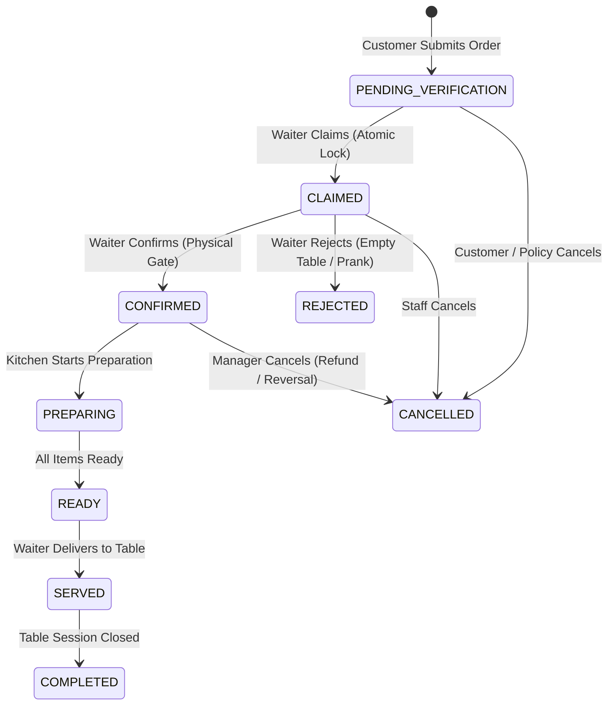
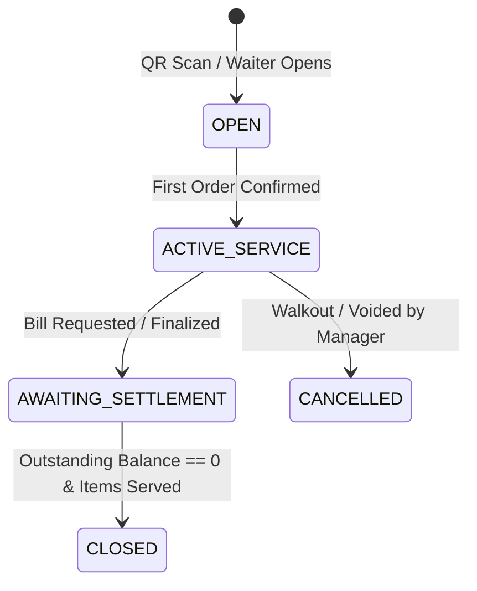
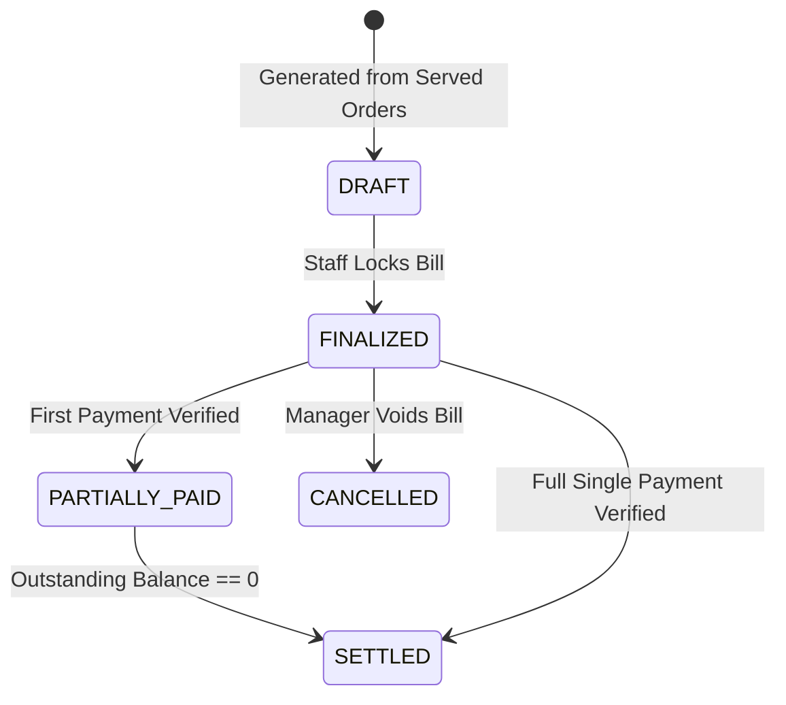

# RESTRO MANAGE — Document 03: Business Rules & State Machines

**Project:** RESTRO MANAGE  
**Document ID:** RM-DOM-001  
**Version:** 1.0  
**Source Document:** [worklow.md](file:///d:/Computer%20science/Restaurant%20Management%20system/worklow.md) (Sections 3–8, 13, 14)  

---

## 1. Core Domain Principles

- **BR-001 Authoritative Server:** The backend re-evaluates all business constraints, item prices, availability, and permissions before committing any change.
- **BR-002 Valid State Transitions Only:** No resource may bypass states (e.g., an order cannot become `CONFIRMED` without completing the `CLAIMED` verification state).
- **BR-003 Immutable Financial Snapshots:** Menu item price changes do not modify the historical prices recorded on placed orders or bills.
- **BR-004 Unified Billing Invariant:** Exactly **one primary bill per table service session**.
- **BR-005 Atomic Waiter Claiming:** Simultaneous claims on the same order must result in exactly one winner and conflict rejections for all others.

---

## 2. Order State Machine

### Transition Guards & Side Effects:
| Current State | Next State | Permitted Actor | Guard Condition | Side Effects |
|---|---|---|---|---|
| Creation | `PENDING_VERIFICATION` | Customer | Valid table session, phone OTP verified | Broadcasts `order:submitted` to waiters |
| `PENDING_VERIFICATION` | `CLAIMED` | Waiter | Order unassigned, waiter on-duty | Locks row atomically, records assignment |
| `CLAIMED` | `CONFIRMED` | Assigned Waiter | Waiter physically verified table | Generates KOT ticket, emits to KDS, queues print job |
| `CLAIMED` | `REJECTED` | Assigned Waiter | Customer absent / invalid request | Logs rejection reason, notifies customer |
| `CONFIRMED` | `PREPARING` | Kitchen Staff | Ticket accepted | Updates preparation timer |
| `PREPARING` | `READY` | Kitchen Staff | All ticket items marked ready | Emits ready alert to assigned waiter |
| `READY` | `SERVED` | Assigned Waiter | Food handed over to table | Rolls items into session's primary bill |

---

## 3. Kitchen Ticket & Item-Level State Machine

$$\text{QUEUED} \longrightarrow \text{PREPARING} \longrightarrow \text{READY} \longrightarrow \text{COMPLETED} \text{ (or CANCELLED)}$$

- **Item-Level Independence:** Each dish within a ticket has its own status (`QUEUED`, `PREPARING`, `READY`).
- **Ticket Ready Rule:** The ticket status transitions to `READY` if and only if:
  $$\forall \text{ item } \in \text{ Ticket: } \text{item.status} = \text{'READY'}$$

---

## 4. Table Service Session State Machine

### Closure Guards:
A session can transition to `CLOSED` only when:
1. `bills.paid_amount_paise == bills.final_total_paise` (Balance is zero).
2. All orders belonging to the session are in terminal states (`SERVED` or `CANCELLED`).
3. No active tickets remain in the kitchen.

---

## 5. Table Reservation State Machine

$$\text{REQUESTED} \longrightarrow \text{OTP_VERIFIED} \longrightarrow \text{AWAITING_DEPOSIT} \longrightarrow \text{CONFIRMED} \longrightarrow \text{COMPLETED / CANCELLED / NO_SHOW}$$

- **No-Overlap Invariant:** No two confirmed reservations or active dining sessions can share the same physical table during overlapping time windows:
  $$[R_{1}.\text{start\_at}, R_{1}.\text{end\_at}] \cap [R_{2}.\text{start\_at}, R_{2}.\text{end\_at}] = \emptyset$$

---

## 6. Bill & Payment State Machine

- **Settlement Rule:** A bill is marked `SETTLED` if and only if the sum of all verified, successful payments equals or exceeds `final_total_paise`.
